<picture>
  <source media="(max-width: 600px) and (prefers-color-scheme: dark)" srcset="./assets/hero-compact-dark.svg">
  <source media="(max-width: 600px) and (prefers-color-scheme: light)" srcset="./assets/hero-compact-light.svg">
  <source media="(prefers-color-scheme: dark)" srcset="./assets/hero-dark.svg">
  
</picture>

  
  
  

  I build web products, backend systems, and the occasional AI experiment. 
  Based in Kathmandu. Open to interesting work and collaborations.

  <picture>
    <source media="(prefers-color-scheme: dark)" srcset="./assets/components/stats-dark.eef19c1ba50b.svg">
    
  </picture>
  <picture>
    <source media="(prefers-color-scheme: dark)" srcset="./assets/components/languages-dark.22f2fd75b131.svg">
    
  </picture>

Private repository totals included · Activity covers the past year · Languages by repository count

<h3 align="center">A year in play</h3>

<picture>
  <source media="(prefers-reduced-motion: reduce) and (prefers-color-scheme: dark)" srcset="./assets/components/breakout-still-dark.2a3d7b7de99a.svg">
  <source media="(prefers-reduced-motion: reduce)" srcset="./assets/components/breakout-still-light.b88860d3fc3a.svg">
  <source media="(prefers-color-scheme: dark)" srcset="./assets/components/breakout-dark.5705cbaa6f4c.svg">
  
</picture>

Daily contributions, with a little arcade energy. <a href="./assets/github-stats.json">Snapshot &amp; scope ↗</a>

<!-- Community components: vn7n24fzkq/github-profile-summary-cards and cyprieng/github-breakout.
     Research: .github/COMPONENTS.md · Maintenance: .github/PROFILE.md -->
